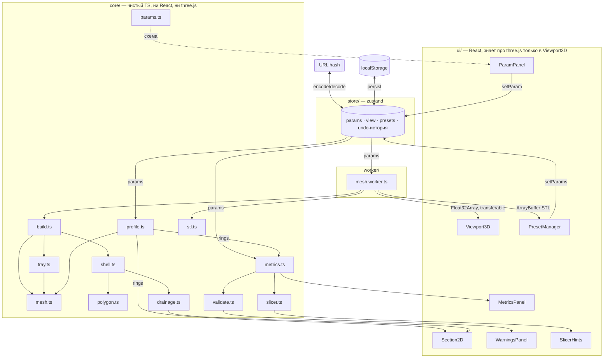

# Архитектура

## Модули и поток данных

Поток строго односторонний: **параметры → core → панели**. Единственный, кто
пишет состояние, — store; core чистый и не имеет побочных эффектов.

---

## Границы модулей

| Слой | Что можно | Чего нельзя |
|---|---|---|
| `core/` | чистые функции над числами и типизированными массивами | импортировать React, three.js, обращаться к `window`, `document`, `localStorage` |
| `worker/` | импортировать `core/`, слать сообщения | трогать DOM |
| `store/` | импортировать `core/` типы и валидаторы | импортировать three.js или компоненты |
| `ui/` | импортировать `core/`, `store/` | считать геометрию у себя |
| `ui/Viewport3D.tsx` | **единственный** файл, который импортирует three.js | — |

Правило проверяемое: `grep -r "three" src/core src/store` должен быть пуст, а
`grep -rl "three" src/ui` — выдавать только `Viewport3D.tsx`.

Зачем такая жёсткость: `core/` полностью покрыт тестами в node-окружении, без
jsdom и без canvas. Как только в него просочится React или three, тесты
превратятся в интеграционные и станут медленными и хрупкими.

---

## Почему геометрия в воркере

Худший случай — `seg = 1024`, `dz = 0.2`, `height = 250`: это 1251 кольцо по
1024 точки, около 2.6 млн треугольников и ~230 МБ float64 внутри. На главном
потоке такая сборка вешает вкладку на секунды: слайдер перестаёт двигаться,
браузер рисует «страница не отвечает».

Воркер решает это, но требует дисциплины:

- **Передача, а не копирование.** Позиции уходят как `Float32Array` через
  transferable-буфер, так что ~30 МБ перемещаются, а не копируются.
- **Дебаунс 120 мс.** Перетаскивание слайдера даёт десятки событий в секунду;
  без дебаунса они выстроились бы в очередь и воркер отставал бы на секунды.
- **Отбрасывание устаревших ответов.** У каждого запроса монотонный id; ответ
  с чужим id игнорируется. Иначе поздний ответ на старые параметры перезапишет
  свежую модель.
- **Метрики считаются на главном потоке.** Кольца (не полный меш) — это
  десятки тысяч точек и единицы миллисекунд, зато панель метрик остаётся живой,
  пока воркер молотит тяжёлый меш.

STL собирается тем же воркером отдельной командой: писать 5–100 МБ буфера на
главном потоке — та же заморозка.

---

## Почему нет бэкенда

- Считать нечего: вся математика — сотни тысяч арифметических операций, это
  миллисекунды в JS. Сервер добавил бы сетевой round-trip к тому, что и так
  быстрее кадра.
- Хранить нечего: параметры целиком помещаются в URL hash, пресеты — в
  localStorage. Аккаунты не нужны, потому что нет ничего, что стоило бы
  привязывать к личности.
- Приложение должно работать в мастерской рядом с принтером, где интернета
  может не быть вовсе.
- Отсутствие сервера — это отсутствие деплоя, сертификатов, бэкапов, миграций
  и утечек. Для инструмента одного человека это решающий довод.

Цена решения: расшаренная ссылка длинная, и «облачной» синхронизации пресетов
между машинами нет — их надо экспортировать в JSON руками.

---

## Состояние и история

`store/usePotStore.ts` держит:

- `params` — текущий набор, всегда прошедший `sanitizeParams`;
- `past` / `future` — стеки undo/redo, до 100 шагов;
- `view` — вкладка, каркас, разрез, сетка;
- `userPresets` — пользовательские пресеты.

Правки, идущие подряд по одному и тому же параметру ближе 500 мс друг к другу,
схлопываются в один шаг истории: иначе одно перетаскивание слайдера съедало бы
весь стек undo.

В localStorage сохраняются параметры, вид и пресеты. История **не**
сохраняется намеренно: восстановленный стек позволил бы «откатиться» в
состояние, которого пользователь в этой сессии не видел.

При загрузке URL hash имеет приоритет над localStorage — ссылка должна
открывать то, что в ней написано.

---

## Тестовая стратегия

| Уровень | Что проверяет | Где |
|---|---|---|
| Golden | побайтовая (в пределах float32) эквивалентность порта `potgen.py` | `tests/golden.test.ts` |
| Топология | манифольдность, ориентация нормалей, объём > 0 | `tests/mesh.test.ts`, `tests/shell.test.ts` |
| Алгоритмы | ресемплинг, симметрия, триангуляция с дырками | `tests/profile.test.ts`, `tests/polygon.test.ts` |
| Правила | таблица валидации построчно | `tests/validate.test.ts` |
| Состояние | undo/redo, пресеты, санитизация | `tests/store.test.ts` |
| Формат | round-trip binary STL | `tests/stl.test.ts` |
| Документация | компиляция всех примеров кода | `pnpm docs:check` |

Golden-фикстуры генерируются **только** в питоновском контейнере
(`make fixtures`) и включают сам эталонный STL в gzip — сравнение идёт по
каждой координате, а не по контрольной сумме: CPython и V8 расходятся на ulp в
`cos`/`sin` у осей, и этого хватает, чтобы изредка перевернуть последний бит
float32.
