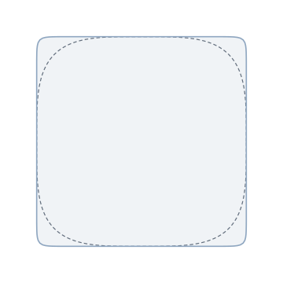
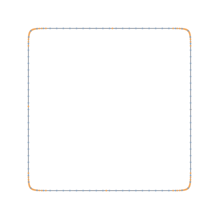
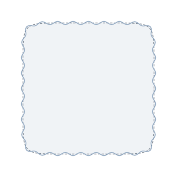
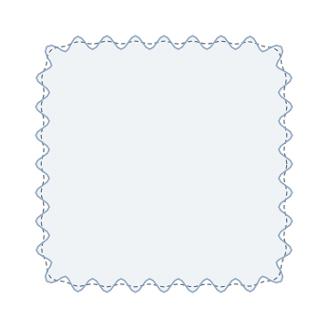
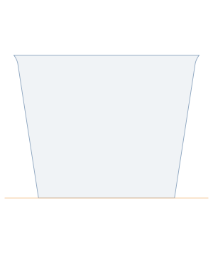
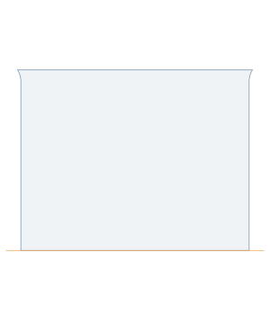
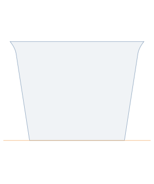

# Геометрия

Разбор всей математики генератора: как строится сечение, почему именно так, и
что каждый параметр делает с формой. Иллюстрации в `docs/figures/` генерируются
скриптом `pnpm docs:figures` из тех же функций, что строят модель, — руками они
не рисуются и разойтись с кодом не могут.

Реализация: [`src/core/profile.ts`](../src/core/profile.ts),
[`src/core/mesh.ts`](../src/core/mesh.ts),
[`src/core/shell.ts`](../src/core/shell.ts),
[`src/core/polygon.ts`](../src/core/polygon.ts).

---

## 1. Сечение: суперэллипс

Скруглённый квадрат задаётся суперэллипсом (кривой Ламе) с полушириной $a$:

$$
x(t) = a \cdot \operatorname{sign}(\cos t) \cdot |\cos t|^{2/k}, \qquad
y(t) = a \cdot \operatorname{sign}(\sin t) \cdot |\sin t|^{2/k},
\qquad t \in [0, 2\pi)
$$

Показатель $k$ управляет «квадратностью»: при $k = 2$ это окружность, при
$k \to \infty$ — квадрат. Нам нужен квадрат с заданным радиусом угла
$r_{\text{corner}}$, поэтому

$$
k = \max\left(2.5,\ \frac{2a}{\max(r_{\text{corner}},\ 0.5)}\right)
$$

**Откуда это.** Кривизна суперэллипса в углу растёт примерно линейно по $k$, а
характерный размер скругления обратно пропорционален $k$: отношение $2a/r$ даёт
показатель, при котором угол выглядит как дуга радиуса $r$. Это приближение, а
не точное равенство — суперэллипс не имеет постоянной кривизны в углу, и
«радиус угла» здесь означает «на глаз похоже на радиус $r$». Для горшка этого
достаточно, а расплата — одна формула вместо построения дуг и касательных.

Нижняя граница 2.5 не даёт сечению выродиться в круг, когда пользователь
просит радиус больше половины стенки. Нижняя граница 0.5 мм на сам радиус
не даёт $k$ уйти в бесконечность при $r \to 0$.



*Пунктиром — `cornerR = 24`, заливкой — `cornerR = 4` при той же ширине.*

Выборка плотная — 720 точек, — и она **не** идёт в модель напрямую.

---

## 2. Ресемплинг по длине дуги

Равномерная выборка по параметру $t$ даёт неравномерную выборку по контуру:
точки скучиваются в углах, где кривая идёт медленно, и разрежаются на прямых
участках. Для гладкого квадрата это косметика, но гофр (раздел 3) задаётся как
функция от **номера точки**, поэтому неравномерность точек превращается в
неравномерность волны: в углах волны частят, на сторонах растягиваются.

Поэтому плотный контур пересэмплируется на $m$ точек, равноотстоящих по длине
дуги. Пусть $L$ — полная длина замкнутой ломаной, $s_j = jL/m$ — целевые
позиции. Для каждой $s_j$ ищется сегмент $[P_i, P_{i+1}]$, в который она
попадает, и точка берётся линейной интерполяцией:

$$
Q_j = P_i + \frac{s_j - S_i}{|P_{i+1} - P_i|}\,(P_{i+1} - P_i),
\qquad S_i = \sum_{q<i} |P_{q+1} - P_q|
$$

Разброс длин сегментов после этого — доли процента (тест
`tests/profile.test.ts` требует < 1 %), тогда как до ресемплинга он превышает
50 %.



*Оранжевые точки — выборка по углу, синие — по длине дуги. Обратите внимание на
углы.*

---

## 3. Гофр

Каждая точка контура смещается вдоль **внешней нормали** на

$$
d(s) = A \cdot \cos(2\pi \cdot N \cdot s), \qquad s = \frac{j}{m}
$$

где $N$ — число волн (`flutes`), $A$ — амплитуда (`fluteAmp`), $j$ — номер
точки. Нормаль берётся из центральной разности соседей: для контура, обходимого
против часовой стрелки,

$$
\mathbf{T}_j = P_{j+1} - P_{j-1}, \qquad
\mathbf{n}_j = \frac{1}{|\mathbf{T}_j|}\begin{pmatrix} T_y \\ -T_x \end{pmatrix}
$$

Центральная разность, а не разность вперёд: она не сдвигает нормаль на полшага
и не заваливает волну в сторону обхода.

**Зачем гофр вообще.** В режиме вазы стенка — одна нитка экструзии, 0.75 мм.
Гладкий квадрат такой толщины мнётся пальцами. Синусоида по периметру
превращает плоскую стенку в набор рёбер: момент инерции сечения стенки растёт
как квадрат амплитуды, а непрерывность контура сохраняется — именно она нужна
слайсеру для спирали. Ничего другого, не разрывая контур, добавить нельзя.

**Почему `flutes` кратно четырём.** Фаза волны привязана к $s = j/m$, а обход
начинается на оси $+x$. При $N \bmod 4 = 0$ период укладывается в четверть
контура целое число раз, четырёхкратная симметрия квадрата сохраняется, и углы
попадают на гребень — там, где жёсткость нужнее всего. При $N \bmod 4 \neq 0$
симметрия ломается (тест `baseProfile` это проверяет: расхождение вырастает с
$10^{-6}$ до долей миллиметра). Поэтому шаг слайдера — 4.

 

*Слева: гладкая стенка (пунктир) против 32 волн. Справа: амплитуда 0.5 против
2.5 мм.*

---

## 4. Профиль по высоте

Модель — стопка сечений с шагом `dz`. Число уровней:

$$
n_z = \max\left(2,\ \operatorname{round}\left(\frac{H}{\Delta z}\right) + 1\right),
\qquad z_i = \frac{H \cdot i}{n_z - 1}
$$

### 4.1 Конус

Полуширина линейно интерполируется между дном и кромкой:

$$
a(z) = \frac{1}{2}\left(W_{\text{bottom}} + (W_{\text{top}} - W_{\text{bottom}})\,\frac{z}{H}\right)
$$

**Зачем.** Вложение. Горшки должны складываться в стопку — иначе сотня горшков
занимает сотню объёмов вместо десяти. Насколько плотно они складываются,
считает `nestingPitch` (см. раздел 6).

 

### 4.2 Масштабирование радиуса и амплитуды

Радиус угла и амплитуда гофра заданы **на кромке** и масштабируются
пропорционально текущему сечению:

$$
r(z) = r_{\text{top}} \cdot \frac{a(z)}{a(H)}, \qquad
A(z) = A_{\text{top}} \cdot \frac{a(z)}{a(H)}
$$

**Зачем.** Постоянный радиус угла сделал бы нижние сечения пропорционально
круглее верхних, и вложенные горшки садились бы вкось: контакт шёл бы по углам
вверху и по сторонам внизу. Постоянная амплитуда дала бы то же самое для
гребней гофра.

### 4.3 Развальцовка кромки

На последних `rimH` миллиметрах контур раздувается наружу. Пусть
$g = (z - (H - h_{\text{rim}}))/h_{\text{rim}} \in (0, 1]$, тогда всё сечение
умножается на

$$
\sigma(z) = \frac{a(z) + f \cdot g^2}{a(z)}
$$

где $f$ — `rimFlare`. Это **равномерное масштабирование** сечения, а не сдвиг
по нормали: так кромка не ломает гофр и остаётся замкнутым контуром.

Квадратичность важна: при линейном законе стенка ломается на видимый угол в
точке $z = H - h_{\text{rim}}$, при $g^2$ производная в этой точке равна нулю и
кромка отходит от стенки по касательной.

**Зачем.** Два дела сразу. Во-первых, упор: без него вложенные горшки
заклинивает намертво — тонкий PETG прилипает к тонкому PETG и стопка
превращается в один предмет. Во-вторых, жёсткость верха: кромка — это то, за
что горшок берут рукой.



### 4.4 Кручение

Опционально всё сечение поворачивается на угол, линейный по высоте:

$$
\theta(z) = \frac{\pi}{180}\,\tau z, \qquad
\begin{pmatrix} x' \\ y' \end{pmatrix} =
\begin{pmatrix} \cos\theta & -\sin\theta \\ \sin\theta & \cos\theta \end{pmatrix}
\begin{pmatrix} x \\ y \end{pmatrix}
$$

Кручение ломает вложение: гребни одного горшка упираются в гребни другого под
углом. Валидатор об этом говорит (уровень `info` — это выбор, а не ошибка).


---

## 5. Триангуляция

### 5.1 Режим вазы: сплошное тело

Между соседними кольцами $i$ и $i+1$ каждая пара соседних точек даёт
четырёхугольник, который делится на два треугольника по диагонали $a$–$c$:

```
d = P(i+1, j) ──── c = P(i+1, j+1)
    │      ╲            │
    │        ╲          │
a = P(i, j) ──── b = P(i, j+1)
```

$(a, b, c)$ и $(a, c, d)$. Снизу и сверху — веер из центра
$(0, 0, z)$. Обход выбран так, что при взгляде снаружи все треугольники идут
против часовой стрелки, то есть нормаль по правилу правой руки смотрит наружу.
Проверяется это интегралом дивергенции:

$$
V = \frac{1}{6}\sum_{\triangle} \mathbf{a} \cdot (\mathbf{b} \times \mathbf{c})
$$

Для замкнутой поверхности с наружными нормалями $V > 0$; тест
`tests/mesh.test.ts` требует именно этого на 20 случайных наборах параметров,
плюс проверяет, что каждое направленное ребро встречается ровно один раз и его
обратное существует — это и есть манифольдность с согласованной ориентацией.

**Почему сплошное тело, а не тонкая стенка.** Слайсер в режиме вазы обводит
внешний контур и игнорирует всё внутри. Тонкостенная модель дала бы вторую
поверхность, которую надо где-то замкнуть, которая может самопересечься в
ложбинах гофра, и которую слайсер всё равно выбросит. Сплошное тело проще,
надёжнее и весит столько же в STL.

### 5.2 Shell: тонкая стенка

Здесь поверхностей две. Внутренний контур строится **гладким** (без гофра) и
смещённым внутрь на

$$
a_{\text{inner}}(z) = a_{\text{outer}}(z)\,\sigma(z) - \big(w + A(z)\,\sigma(z)\big)
$$

Слагаемое $A(z)$ здесь принципиально: гофр смещает внешнюю поверхность **внутрь**
на амплитуду в каждой ложбине, поэтому отступ на одну лишь толщину стенки $w$
оставил бы в ложбинах бумагу. С таким отступом тонкое место равно ровно $w$, а
на гребнях стенка толще на $2A$.

Тело собирается из: внешней стенки, внутренней стенки (обход развёрнут — она
смотрит в полость), кольцевой площадки кромки, дна-плиты с двумя гранями
(нижняя смотрит вниз, верхняя — в полость) и цилиндров дренажных отверстий.

### 5.3 Дно с отверстиями

Веер из центра не выражает дырки, поэтому дно триангулируется как многоугольник
с отверстиями: каждое отверстие «вшивается» в контур мостом (bridge), после
чего получившийся простой многоугольник режется отсечением ушей (ear clipping).

Мост ищется так: от **самой левой** вершины отверстия пускается луч в $-x$,
берётся **ближайшее** пересечение с контуром, затем среди видимых вершин
выбирается та, что даёт наименьший угол к лучу. Оба уточнения — не украшение:

- если брать не ближайшее пересечение, мост проходит сквозь соседнее
  отверстие, и многоугольник перестаёт быть простым;
- если два отверстия имеют одинаковую координату $x$ (а при симметричной
  раскладке это ровно наш случай), нужен тай-брейк по «ширине сектора»,
  иначе оба моста уходят в одну вершину и пересекаются.

Именно на четырёх симметричных отверстиях наивная версия и разваливалась.

### 5.4 Щели

Щели вырезаются по ячейкам сетки стенки: ячейка $(i, j)$ либо целиком есть,
либо целиком вырезана. Это отказ от булевой операции в пользу привязки к сетке
— ширина и высота щели округляются до ближайшего сегмента и `dz`, зато
результат манифолден по построению.

По периметру выреза достраиваются четыре «откоса», соединяющие внешнюю
поверхность с внутренней. Обход каждого откоса развёрнут относительно того
квада стенки, с которым он делит ребро: одинаковое направление означало бы
дублирующееся направленное ребро, то есть дыру в поверхности, а не шов.

---

## 6. Шаг вложения

Насколько вырастает стопка от добавления горшка. Считается не по формуле
конуса, а опусканием копии до касания.

Пусть $R(z)$ — огибающая радиуса сечения (максимум $\sqrt{x^2+y^2}$ по
контуру). Копия, поднятая на $p$, помещается в горшок ниже, если её внешняя
поверхность нигде не задевает внутреннюю поверхность нижнего:

$$
\forall z \le H - p: \quad R(z) \le R(z + p) - w
$$

Минимальный такой $p$ (с точностью до шага `dz`) и есть шаг вложения.
Огибающая, а не сам контур: касаются только гребни гофра и углы.

Из шага считается, сколько горшков влезает в 250 мм рабочей высоты:

$$
n = \left\lfloor \frac{250 - H}{p} \right\rfloor + 1
$$

Для одностенного горшка шаг выходит небольшим (стенка тонкая, вкладываются
глубоко) — это честный результат модели, а не ошибка: заводские P9 толще и
складываются с бо́льшим шагом.

---

## 7. Что считает валидатор

Границы печатаемости выведены из тех же формул:

| Условие | Откуда |
|---|---|
| период гофра $P_{\text{rim}}/N < 3$ мм | сопло 0.4 мм физически не выведет волну короче трёх диаметров |
| $A > (P_{\text{rim}}/N)/3$ | склон волны круче ~45°, экструдер не успевает за поворотом |
| $w > 2 d_{\text{nozzle}}$ | предел ширины экструзии для круглого сопла |
| угол стенки $\arctan\frac{W_{\text{top}} - W_{\text{bottom}}}{2H} > 45°$ | свес, в режиме вазы нитка ложится в воздух |
| $W_{\text{bottom}} > W_{\text{top}}$ | обратный конус: и вложение невозможно, и свес по всей высоте |
| $r_{\text{corner}} > W_{\text{bottom}}/2$ | углы схлопываются, сечение вырождается |

Период меряется по **гладкому** контуру кромки, а не по гофрированному: гофр
удлиняет периметр, и слишком частая волна начинает льстить сама себе — её
период выглядит просторнее, чем есть.
